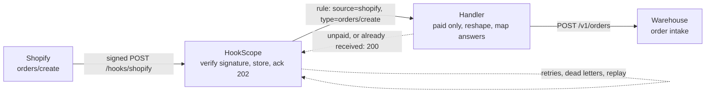
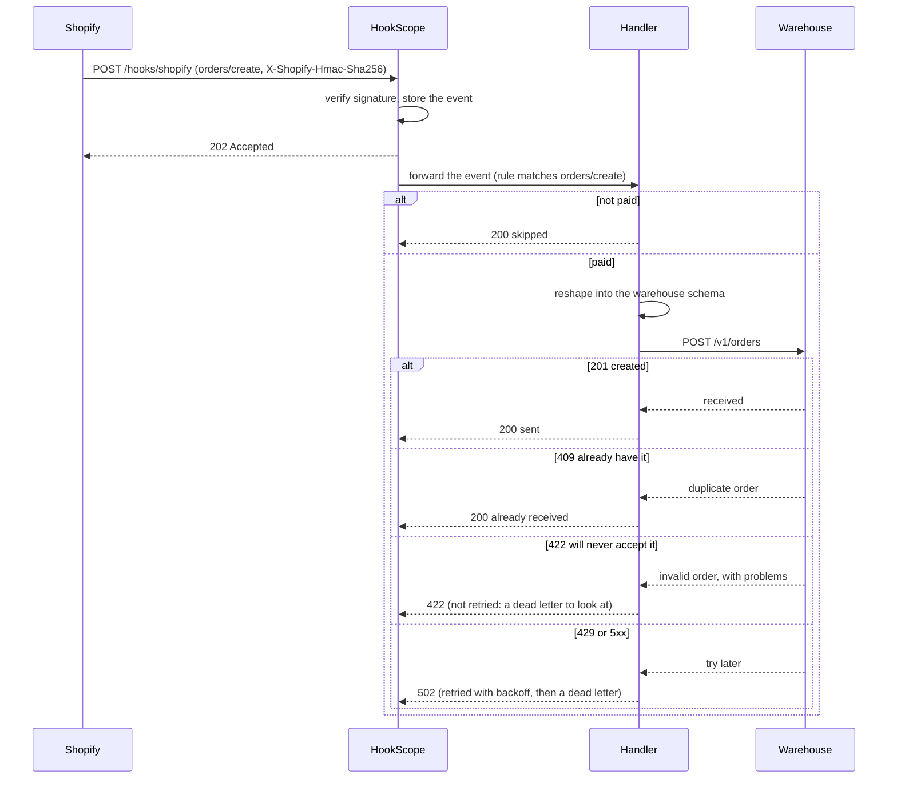

# shopify-order-to-warehouse

Send every paid Shopify order to the warehouse in the shape the warehouse wants, once, and make a warehouse
outage a delay instead of a pile of lost orders.

| Part | Status |
|---|---|
| 1. Problem and architecture | done |
| 2. Config | done |
| 3. Core code | done |
| 4. Happy-path tests | done |
| 5. Failure-mode tests | done |
| 6. Troubleshooting | done |
| 7. Customer pack | done |

## 1. Problem and architecture

### The scenario

A small online shop sells through Shopify and ships from a third-party warehouse. The warehouse has its
own order intake API and a strict schema: an order id, lines made of a SKU and a positive whole quantity,
and a shipping address in its own field names. Someone currently copies orders across by hand each
morning. The shop wants every **paid** order to reach the warehouse within seconds of checkout, and it
wants three things to stay true when things go wrong:

- **No order is lost when the warehouse is down.** Maintenance windows and outages happen; the orders
  placed during one must arrive afterwards.
- **No order is shipped twice.** Shopify may deliver a webhook more than once, HookScope retries a failed
  delivery, and a person may re-send one by hand. The warehouse must still see each order once.
- **An order that cannot be shipped is visible, not silently retried forever.** A line item without a SKU
  (a custom charge, a gift card) is a data problem a retry cannot fix; someone has to look at it.

### What must be true

| Requirement | Why it matters |
|---|---|
| Only verified Shopify events are acted on | Anyone can POST to a public URL; `X-Shopify-Hmac-Sha256` is the proof |
| Only paid orders go to the warehouse | `orders/create` also fires for unpaid and pay-later orders |
| The warehouse receives its own schema, not Shopify's | It rejects what it does not recognise, and it should not get data it does not need (the customer's email, prices) |
| The order id is kept exact | Shopify ids are 64-bit integers; as JSON numbers they lose digits in many languages, so the id travels as a string |
| A repeat of an order is a success, not an error | The warehouse answers `409` for an order it already has; that is the proof it arrived |
| A warehouse outage loses nothing | Failed deliveries are retried with backoff, then kept as dead letters that can be replayed |
| An order the warehouse will never accept is visible | A `422` is permanent: HookScope does not retry it and lists it as a dead letter with the reason |
| Events that need no action are not errors | Unpaid orders answer 2xx, so HookScope does not retry something deliberately skipped |

### Where the filter and the reshaping live

HookScope forwarding rules match on the **source** and the **event type**. For Shopify the event type is
the `X-Shopify-Topic` header, so a rule can pick `orders/create` but cannot pick "paid only", which is a
value inside the payload, and it cannot reshape a body. Both therefore live in a small handler between
HookScope and the warehouse, which is the code this recipe builds (part 3). Routing stays in the receiver;
the business rules and the mapping live in code that can be tested.

### Architecture



### One delivery, step by step



### The mapping

| Warehouse field | From the Shopify order | Notes |
|---|---|---|
| `order_id` | `id` | As a string, so no digit is lost |
| `reference` | `name` (`#1001`) | What the shop's staff recognise |
| `lines[].sku` | `line_items[].sku` | Required; a line without one cannot be shipped |
| `lines[].qty` | `line_items[].quantity` | A positive whole number |
| `lines[].title` | `line_items[].title` | For the packing slip |
| `ship_to.name`, `address1`, `city` | `shipping_address` | Same names |
| `ship_to.region` | `shipping_address.province_code` | |
| `ship_to.postal_code` | `shipping_address.zip` | |
| `ship_to.country` | `shipping_address.country_code` | |

Not sent: the customer's email and phone, prices and totals. The warehouse does not need them to ship a
parcel. The sample event used by the tests is built by `common/fixtures.py`: `shopify_order_created()`.

### Decisions made up front

1. **The warehouse's own duplicate answer is the deduplication.** Instead of the handler keeping a table of
   orders it has seen, a `409` from the warehouse means "already have it" and counts as success. That is
   safe across restarts, retries and manual re-sends, and it needs no state in the handler. The price is
   that the warehouse must really answer `409` for a repeated order id, which is a question for the
   customer's warehouse (part 7).
2. **Only paid orders go.** Others are acknowledged and skipped, never an error. The alternative, listening
   to `orders/paid` instead, suits pay-later shops and is a one-line change in `rules.json`.
3. **Permanent and temporary failures are told apart.** `422` (the warehouse will never accept this order)
   passes through as `422`, which HookScope does not retry, so the order shows up in the dead-letter list
   with its reason. `429` and `5xx` become `502`, which HookScope retries with backoff.
4. **A skipped order is logged with its reason**, so "why did order #1042 not reach the warehouse?" is
   answered by one log line.
5. **The warehouse is a mock in the tests**: `common/mocks.WarehouseMock` stands in for it, including its
   `409` for duplicates and its `422` schema check, and the recipe says so rather than claiming it was
   exercised against a real warehouse.

## 2. Config

Three files describe the setup; nothing here is code.

| File | What it does |
|---|---|
| [`rules.json`](rules.json) | HookScope's forwarding rule: events from `shopify` of type `orders/create` go to the handler, with up to 6 attempts and exponential backoff from 5 s to 5 min |
| [`docker-compose.yml`](docker-compose.yml) | Adds the handler and a mock warehouse to HookScope (from the repository's base compose file) and makes HookScope wait for the handler to be healthy |
| [`recipe.env`](recipe.env) | The handler's settings: which financial states are sent, and the warehouse timeout |

### The rule

```json
{
  "name": "order-created",
  "source": "shopify",
  "event_types": ["orders/create"],
  "target_url": "http://handler:8080/shopify/order-created",
  "retry": {"attempts": 6, "backoff_seconds": 5, "max_backoff_seconds": 300}
}
```

- `source` and `event_types` keep every other provider, and every other Shopify topic (`orders/updated`,
  `products/update`, ...), away from the handler. For Shopify the event type is the `X-Shopify-Topic`
  header, so `orders/create` is matched there; whether the order is paid is the handler's business (part 1).
- The retry policy is longer than the other recipes' because a warehouse outage is measured in minutes, not
  seconds: HookScope waits 5, 10, 20, 40 and 80 seconds between the six attempts, about two and a half
  minutes plus request durations. The handler does not pass the warehouse's `Retry-After` header through.
  A longer outage ends as a dead letter that can be
  re-sent from the dashboard, which is the intended way to recover from an outage that long.
- Only events whose signature verified are forwarded; a forged request is stored and never reaches the handler.

### Settings

| Setting | Where | Meaning |
|---|---|---|
| `HOOKSCOPE_SECRET_SHOPIFY` | `.env`, written by `make env` | The secret HookScope verifies `X-Shopify-Hmac-Sha256` with. The demo value comes from `common/fixtures.py`; in production it is the signing secret of your Shopify app or webhook |
| `WAREHOUSE_BASE_URL` | `docker-compose.yml` | Where the handler sends orders (`POST /v1/orders`). It points at the mock warehouse; put the real intake URL here to try it for real |
| `WAREHOUSE_API_KEY` | `docker-compose.yml` | The credential the warehouse issued. The mock ignores it and the value here is a placeholder; a real one belongs in your secret store, not in git |
| `FULFIL_FINANCIAL_STATUSES` | `recipe.env` | The Shopify `financial_status` values that are sent, comma separated (`paid`). Everything else is acknowledged and skipped |
| `WAREHOUSE_TIMEOUT_SECONDS` | `recipe.env` | How long the handler waits for the warehouse before asking HookScope to retry |

### Run it

```bash
make env                                              # write .env with the demo secrets
make up RECIPE=shopify-order-to-warehouse             # HookScope, the handler and a mock warehouse
python -m common.send shopify_order_created total=199.00
curl localhost:9002/v1/orders/820982911946154508      # what the "warehouse" now holds
make down RECIPE=shopify-order-to-warehouse
```

`common.send` signs a realistic `orders/create` event the way Shopify does and posts it to HookScope, so the
whole path runs: verification, the rule, the handler, the warehouse.

Compose resolves every relative path against the repository root (the first `-f` file), so the paths in
this recipe's compose file start with `./recipes/shopify-order-to-warehouse/`.

## 3. Core code

The [handler](handler/app.py) receives the original order JSON from HookScope, filters on the configured
financial statuses and sends the mapped order to `POST /v1/orders`. It sends the configured warehouse key
as a bearer credential. The warehouse owns deduplication by order ID, so the handler stores no local state.

## 4. Happy-path tests

[`test_shopify_happy_path.py`](test_shopify_happy_path.py) sends a signed `orders/create` fixture
through HookScope, the HTTP handler and the mock warehouse. It checks verification, the forwarding
result, the exact order ID and the mapped lines and address.

## 5. Failure-mode tests

[`test_shopify_failures.py`](test_shopify_failures.py) covers transient warehouse 429/500 responses,
duplicate deliveries, distinct orders arriving out of creation order, a late unpaid delivery, exhausted
retries and repeated manual resend after recovery. [`test_warehouse_handler.py`](test_warehouse_handler.py)
also checks invalid lines and warehouse response mapping. Run these with HookScope source on
`PYTHONPATH` and its dependencies installed; otherwise the end-to-end tests skip:

```bash
make test RECIPE=shopify-order-to-warehouse
```

## 6. Troubleshooting

### Start with the stored event

A `202` acknowledges receipt by HookScope; it does not prove that the warehouse accepted the order.
Use the stored event ID to connect verification, forwarding attempts and any dead letter. The Shopify
order ID and HookScope event ID are different identifiers.

Run from the repository root while the recipe is up. These commands use the demo's default port and
unauthenticated local configuration. For a secured deployment, use its configured authentication and URL.

```bash
curl -sS 'http://localhost:8000/api/events?source=shopify&limit=20'
# Replace 1 with the HookScope event ID returned above.
curl -sS http://localhost:8000/api/events/1
curl -sS http://localhost:8000/api/events/1/forwards
curl -sS http://localhost:8000/api/dead-letters
curl -sS http://localhost:8000/metrics
make logs RECIPE=shopify-order-to-warehouse
```

### Symptoms, checks and fixes

| Symptom | Likely cause | How to check | Fix |
|---|---|---|---|
| No stored event | Wrong webhook URL or receiver unavailable | Check Shopify's delivery result, receiver health and request logs | Point Shopify at the reachable `/hooks/shopify` endpoint; restore receiver connectivity |
| Event stored but verification is invalid | Wrong signing secret or altered body bytes | Inspect the event's verification result and Shopify signature header | Configure the app/webhook signing secret; preserve the exact signed bytes through proxies; do not bypass verification |
| Valid event has no forwards | Topic or loaded rules do not match | Compare `X-Shopify-Topic` with `orders/create`; inspect `/api/rules` for `order-created` | Load this recipe's rules and restart/recreate HookScope after changing its configuration |
| Forward is 200 but no warehouse order | Financial status was deliberately skipped | Check the original `financial_status` and handler skip log | Confirm the fulfilment policy; this recipe listens to `orders/create`, so a later payment does not automatically produce another matching event |
| Forward is 422 | Missing SKU, invalid quantity/address or warehouse schema rejection | Inspect the stored body and handler response; check warehouse validation details at the target | Correct the source data or mapping before a new delivery; resending the unchanged stored body cannot repair bad input |
| Attempts show 502 | Warehouse 429/5xx, timeout, DNS/connectivity problem or another unexpected warehouse status | Read handler logs for the upstream status or request failure; check the warehouse URL and service health | Restore connectivity/capacity or correct the endpoint/credential; then resend a dead letter after recovery |
| Six failed attempts and a dead letter | Outage lasted beyond the configured retry window | Inspect attempts 1 through 6 and the dead letter's `resendable` field | Resolve the target failure, then use the single-forward resend below |
| Repeated delivery is 200 and the order count stays one | Warehouse answered 409 for the same order ID | Check the order at the warehouse and forwarding history | Expected duplicate handling; verify the real warehouse's 409 contract before relying on it |
| A corrected order does not replace the existing warehouse order | This intake treats an existing order ID as already received | Compare the stored order with the new payload | Use the warehouse's amendment workflow; this recipe does not implement order updates or cancellations |

The handler maps warehouse 429 to 502 and does not propagate its `Retry-After` header. HookScope uses
the recipe's own backoff: 5, 10, 20, 40 and 80 seconds between six attempts, plus request durations.
A permanent 422 receives no automatic retry and can also appear in the dead-letter list.

### Observed outage logs and metrics

The following excerpts were captured from a local run with the same signed fixture, handler and pinned
HookScope source used by the integration tests. The mock warehouse returned 500 six times. Backoff
sleeping was disabled in the test; production waits according to the rule. Timestamp and request-ID
prefixes are omitted from HookScope log lines here:

```text
event received event_id=1 source=shopify verification=valid reason=None cause=None delivery_id=None bytes=415
order 820982911946154508: warehouse returned 500
forward attempt event_id=1 rule=order-created attempt=1 status_code=502 elapsed_ms=31 error=None
forward attempt event_id=1 rule=order-created attempt=6 status_code=502 elapsed_ms=15 error=None
```

The handler line identifies the upstream 500; the forwarding record reports the handler's 502. For a
network failure the handler instead logs `order <id>: warehouse request failed`. A skipped financial
status logs `order <id> skipped: financial status is not configured for fulfilment` at INFO level.

Selected `/metrics` samples after the six failures:

```text
hookscope_deliveries_total{source="shopify",verification="valid"} 1
hookscope_forward_attempts_total{rule="order-created",outcome="failure"} 6
hookscope_dead_letters 1
```

Delivery counts measure received webhooks; forward counts include retry attempts. Neither is a count
of unique fulfilled orders. The dead-letter gauge includes all rules, so inspect `/api/dead-letters`
to identify this recipe's failures. Watch for a rising failure count or a nonzero dead-letter gauge;
check the warehouse itself to confirm fulfilment.

### Recover without creating a second shipment

1. Confirm the warehouse is healthy and that order-ID deduplication still works. Check whether it
   accepted the order even if the original response was lost.
2. Inspect the event, its attempts and the `order-created` dead letter. Resolve data/configuration
   errors first. A stored payload remains unchanged when it is resent.
3. Resend only the affected forward, substituting its HookScope event ID:

```bash
curl -sS -X POST http://localhost:8000/api/events/1/forwards/order-created/resend
curl -sS http://localhost:8000/api/events/1/forwards
curl -sS http://localhost:8000/api/dead-letters
curl -sS http://localhost:9002/v1/orders/820982911946154508
```

The resend endpoint's HTTP 200 means the request to the target completed; inspect the JSON
`status_code` and `ok` too. In the captured recovery, these were `200` and `true`, with
`response_body` equal to `{"result": "sent"}` and `attempt` equal to `7`. A second resend succeeded
without adding an order because the warehouse's 409 became `already_received`.

After the successful resend, the failure counter remained 6, a success sample appeared and the
dead-letter gauge cleared:

```text
hookscope_forward_attempts_total{rule="order-created",outcome="failure"} 6
hookscope_forward_attempts_total{rule="order-created",outcome="success"} 1
hookscope_dead_letters 0
```

Use the forwarding resend endpoint rather than replaying the payload directly to the warehouse:
the handler must still apply filtering, schema mapping and duplicate response handling. Keep the
event store while investigating. `make down` includes `-v` and deletes the demo data volume, so it
is unsuitable for preserving pending events during recovery.

## 7. Customer pack

### FAQ

**What is included?** A verified `orders/create` webhook, a paid-order filter, conversion to the
warehouse intake schema, retryable delivery, dead-letter inspection and manual resend. The warehouse
is a mock. Completion of this recipe means the example and its tests are complete, not that a customer
deployment has been validated against a real Shopify shop or warehouse.

**When is an order sent?** Only when its `financial_status` is in `FULFIL_FINANCIAL_STATUSES`, which
defaults to `paid`. An unpaid creation event is skipped successfully. A later payment is outside this
recipe's subscribed topic. Supporting pay-later orders requires agreeing a payment event and validating
its payload and mapping before changing the subscription and forwarding rule.

**Does this guarantee exactly one shipment?** The handler relies on the warehouse atomically rejecting
an existing `order_id` with 409. Repeats and manual resends then return success without creating another
order. Confirm that contract, its concurrency behaviour and its retention period with the real target.
If 409 also means another kind of conflict, the response mapping must be changed before use. The recipe
does not control the warehouse's physical shipment process or provide an end-to-end exactly-once guarantee.

**What happens if the warehouse accepts an order but its response is lost?** HookScope can retry the
delivery. A warehouse that retains and enforces the order ID should answer 409 on that retry. Verify
this ambiguous-response scenario against the customer's target before go-live.

**What happens during an outage?** Warehouse 429/5xx and connection failures become handler 502
responses. HookScope tries up to six times, then retains a dead letter for manual resend. The wait
intervals total 155 seconds plus request durations; the warehouse's `Retry-After` is not propagated.
Recovery depends on preserving HookScope's event store and acting before retained data is deleted.

**Can we fix bad input by clicking resend?** No. Missing SKUs, invalid quantities and warehouse 422
responses need investigation. Resend uses the original stored body. Correct the source data or mapping
and arrange an appropriate corrected delivery; do not expect replay to fetch the latest Shopify order.

**What about changes, cancellations and older events?** Different orders can arrive in any creation
order. A late unpaid event is skipped. An existing warehouse order is not overwritten by another
creation event. Updates, cancellations, refunds, inventory reservation, partial fulfilment and historical
backfill are outside this recipe and need separate business rules.

**Can it serve multiple shops?** Not safely as a shared deployment without additional design. The
handler sends a single order ID as the warehouse key and has no shop allow-list or shop-specific routing.
Agree shop isolation and an order-key namespace before combining shops or other order sources.

**Which customer data travels or remains stored?** The warehouse receives the order reference, lines
and shipping address. Email, phone and prices are not included in that mapped request. HookScope still
stores the original webhook, which can contain those fields. Set access controls, storage protection,
retention and deletion procedures for the original payload and logs as well as the target system.

**Where do credentials and trust boundaries sit?** HookScope verifies the Shopify signature. The
handler expects trusted forwarding from HookScope and does not independently verify that signature or
authenticate its caller. Keep the handler on a private network. Replace demo secrets and the warehouse
demo key, use a secret store and restrict dashboard/API access. Configure HTTPS at the public boundary
and for a real warehouse endpoint; this local demo uses HTTP.

### Discovery questions

| Area | Questions to settle with the customer | Decision to record |
|---|---|---|
| Order eligibility | Which shops, sales channels and financial states qualify? Are pay-later, manual and partially paid orders in scope? | Shop boundary, subscribed topic and fulfilment policy |
| Target contract | Which intake endpoint and authentication are required? Are SKU, address and quantity rules compatible? | Validated schema and field mapping, including address requirements |
| Duplicate safety | Is order ID unique across sources? Is creation atomic? Does 409 always mean already accepted? How long are IDs retained? | Idempotency key, conflict semantics and response-loss procedure |
| Order lifecycle | Who handles amendments, cancellations, refunds and an order paid after creation? | Explicit scope and separate workflows for unsupported events |
| Failures and volume | What are normal/peak rates, warehouse limits, outage lengths and acceptable delivery delay? | Capacity evidence, retry budget and escalation threshold |
| Recovery | Who owns dead letters, source corrections and replay? What is the cutoff before data retention removes an event? | Named owner, response time and recovery procedure |
| Security and privacy | Who rotates secrets? Who can inspect payloads or resend? How are addresses and full webhooks retained and deleted? | Access, network, encryption and retention controls |
| Acceptance and cutover | Which real-shop/warehouse test environment is available? Is manual import still running? | Acceptance evidence, cutover window and reconciliation owner |

### Go-live checklist

Treat these as customer deployment gates. They are intentionally unchecked; local mock tests do not
complete them. Capture evidence and an owner for each item in the customer's handover record.

**Contract and scope**

- [ ] Confirm the shop/source boundary, order-ID namespace, eligible financial states and subscribed topic.
- [ ] Validate the mapped schema against the actual warehouse, including SKU rules, quantities and addresses.
- [ ] Verify that repeated and concurrent submissions of one ID create one target order and that 409 has
      the expected meaning. Exercise an accepted order whose response is lost, then retry it.
- [ ] Agree how unsupported updates, cancellations, later payments and backfill are handled operationally.

**Deployment and access**

- [ ] Configure the Shopify webhook endpoint and signing secret; confirm signature verification for a real
      authorized delivery. Confirm that an invalid signature never reaches the handler.
- [ ] Set the real warehouse URL, credential, allowed financial states and timeout; remove demo values.
- [ ] Protect the public receiver with HTTPS, restrict dashboard/API access, and keep the handler reachable
      only by trusted services. Confirm the warehouse transport and credential-rotation procedure.
- [ ] Persist and back up the event store; test restoration and confirm retention covers the recovery window.
      Do not use `make down` to preserve data: it removes volumes.
- [ ] Agree access and deletion controls for stored full webhooks, shipping addresses, backups and logs.

**Acceptance evidence**

- [ ] Send one eligible real test order and reconcile its exact ID, line quantities and address at the target.
- [ ] Verify unpaid skip behaviour and duplicate delivery without an extra warehouse order.
- [ ] Exercise 429/500, timeout, permanent validation failure, exhausted retries and recovery in an approved
      test environment. Confirm the recorded attempts and dead-letter result match the agreed contract.
- [ ] Resend one failed order after recovery, inspect the resend JSON as well as its HTTP status, and verify
      the warehouse record and cleared dead letter. Repeat resend to confirm duplicate safety.
- [ ] Measure peak-load delivery time and rate-limit behaviour against the customer's acceptance target.

**Handover and cutover**

- [ ] Assign an operator and escalation contact for dead letters and validation errors; configure alerts
      using the metrics in [Troubleshooting](#6-troubleshooting) and confirm someone receives them.
- [ ] Record the deployment version, configuration, secret owners and backup/restore instructions.
- [ ] Coordinate manual-import shutdown to avoid overlapping order sources, then reconcile a bounded
      cutover set between Shopify and the warehouse.
- [ ] Agree a stop procedure: disable the upstream subscription/forwarding as appropriate, retain pending
      events, reconcile orders already accepted and resume only after the duplicate contract is verified.
      Disabling a subscription alone does not cancel forwards already running.

Handover includes this README, the rule and environment configuration, the test results and the
customer's completed acceptance record. Keep credentials and customer order data out of repository files.
