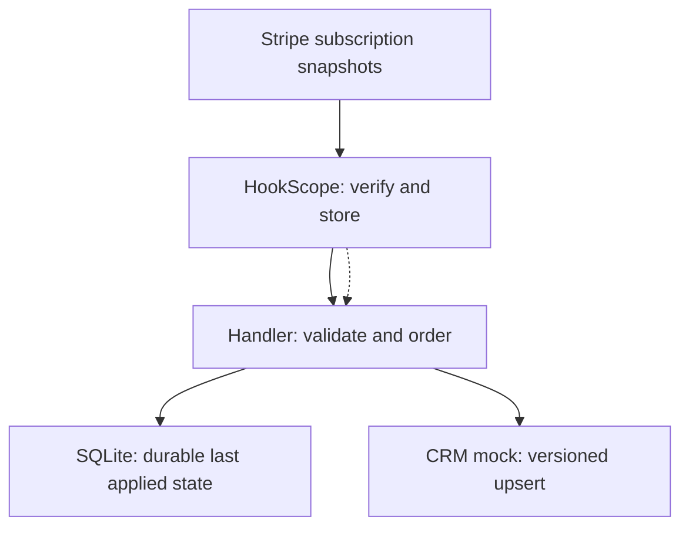
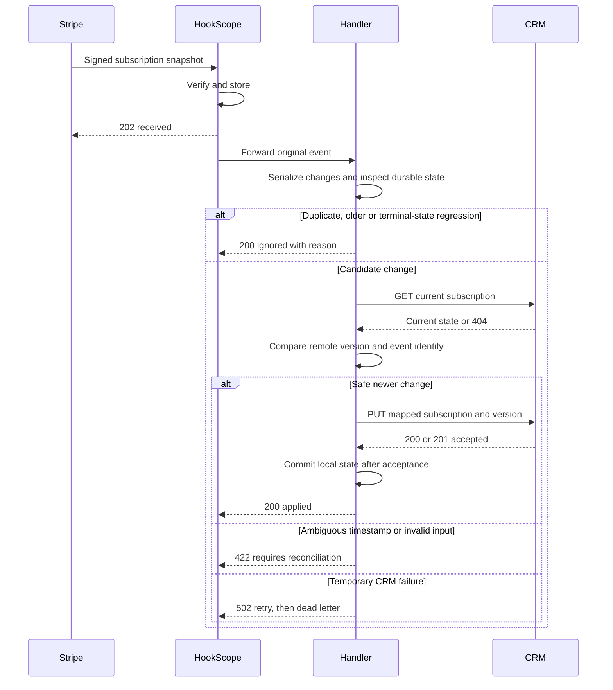

# stripe-subscription-lifecycle-to-crm

Keep the CRM's subscription state useful when Stripe sends duplicate events or delivers an older
snapshot after a newer one. This example targets the repository's CRM mock, not a certified vendor API.

| Part | Status |
|---|---|
| 1. Problem and architecture | done |
| 2. Config | done |
| 3. Core code | done |
| 4. Happy-path tests | done |
| 5. Failure-mode tests | done |
| 6. Troubleshooting | done |
| 7. Customer pack | done |

## 1. Problem and architecture

### Customer problem

Sales and support need a CRM record that distinguishes a trial, a paying customer, a payment problem
and an ended subscription. Delivery order is not lifecycle order: an old `customer.subscription.updated`
event can arrive after cancellation, and retries can deliver the same event repeatedly.

The handler accepts full subscription snapshots for `customer.subscription.created`,
`customer.subscription.updated` and `customer.subscription.deleted`. HookScope verifies Stripe's
signature and routes these topics; the handler maps state and controls ordering. Thin events requiring
an additional Stripe API fetch are outside this example.

### Architecture



### Delivery sequence



### State mapping

| Stripe status | CRM stage | Policy |
|---|---|---|
| `incomplete` | `pending` | Await initial payment |
| `trialing` | `trial` | Trial is in progress |
| `active` | `customer` | Current paying subscription |
| `past_due`, `unpaid`, `paused` | `at_risk` | Support or payment follow-up needed |
| `canceled`, `incomplete_expired` | `inactive` | Terminal for this subscription ID |

A newer snapshot can change any nonterminal status, including recovery from `past_due` to `active`.
Once terminal, a snapshot cannot revive the same subscription ID. A new subscription uses a new ID.
Deletion must carry `canceled` status; a contradictory deletion is rejected rather than guessed.

### Ordering and duplicate contract

- The CRM key is the subscription ID, scoped to one Stripe account per deployment.
- `event.created` supplies the integer version. Older versions are ignored; the same event ID at the
  same version is a duplicate. Distinct events with the same timestamp return 422 for reconciliation.
  Second-resolution timestamps are not a complete ordering key; this example does not invent an order
  by sorting event IDs or pretend it can resolve all same-second changes.
- One shared SQLite database serializes handler writes. The handler checks the CRM's current version
  and event ID before writing, so an accepted update whose response or local commit was lost can be
  recognized on retry. The CRM must preserve these fields and reject lower versions atomically.
- CRM 409 counts as stale only when its structured response reports a strictly newer version. Other
  conflicts remain visible failures. Uncoordinated external writers and multiple independent databases
  are outside the concurrency contract; do not deploy them against the same records.
- Local state advances only after target acceptance. Keep the database and HookScope's event store on
  persistent volumes. A failed write must remain retryable, not be remembered as delivered.
- The mapped CRM record contains subscription ID, customer ID, Stripe status, CRM stage, source event
  ID and version. It omits billing/payment details; the original webhook remains in HookScope's store.

The handler trusts HookScope's private forwarding network. It is not another public webhook verifier.
Protect receiver administration, isolate the handler and replace demo credentials before any deployment.

## 2. Config

[`rules.json`](rules.json) routes only the three subscription lifecycle topics to the handler.
Failures retry up to five times, with 2, 4, 8 and 16 seconds of backoff between attempts.
[`docker-compose.yml`](docker-compose.yml) extends the base receiver with a handler and the CRM mock.
The `subscription-state` volume holds the handler's SQLite database. The mock CRM itself is in memory;
restarting it loses its records. A real target needs its own persistence and backup policy.

| Setting | Purpose |
|---|---|
| `HOOKSCOPE_SECRET_STRIPE` | Receiver signing secret, supplied by `.env`; `make env` writes demo values |
| `CRM_BASE_URL` | CRM base URL, defaulting to the Compose mock for this example |
| `CRM_API_KEY` | Bearer key; the mock ignores its demo value |
| `CRM_TIMEOUT_SECONDS` | Per-request timeout, default 5 seconds |
| `STATE_DB_PATH` | Durable SQLite path, `/data/subscriptions.db` in Compose |
| `LOG_LEVEL` | Handler log level |

Run from the repository root:

```bash
make up RECIPE=stripe-subscription-lifecycle-to-crm
python -m common.send stripe_subscription_lifecycle
curl -sS http://localhost:9003/subscriptions/sub_demo
```

The signed demo creates a trial subscription with ID `sub_demo`. The GET returns 404 until a
subscription is sent. The core handler supplies the application entry point.
The handler is not exposed on a host port. Do not use `make down` when preserving
recovery data: it removes volumes. With no Docker CLI available locally, configuration is checked by
the repository's YAML/routing tests; actual Compose validation and container startup remain CI/deployment checks.

## 3. Core code

[`handler/app.py`](handler/app.py) uses only Python's standard library. `snapshot` validates full
subscription events and maps status to CRM stage. `decision` applies ordering, duplicate and terminal
policy. `Handler` serializes updates with a SQLite write transaction, checks the CRM, sends its upsert,
then records success locally. CRM GET responses must include `id`, `version`, `event_id` and `status`.

`GET /healthz` checks process liveness, not CRM/disk readiness. `POST /stripe/subscription` accepts a
forwarded JSON body up to 1 MB. It returns 200 for applied/skipped/duplicate/stale/terminal events,
400 for unreadable JSON, 422 for invalid input or timestamp ambiguity, and 502 for temporary CRM/storage
failure. Unknown conflicts stay retryable rather than becoming silent success. Redirects are refused
so bearer credentials cannot travel to a redirected host.

[`test_subscription_core.py`](test_subscription_core.py) checks lifecycle changes, persistence across
handler restart, duplicate/stale/colliding timestamps, remote acceptance before local commit, 429/500
write recovery, shared-database concurrency, input validation and the actual HTTP endpoint. These core
tests do not replace the signed HookScope happy-path and full outage/replay tests in parts 4 and 5.

SQLite serializes CRM calls and limits throughput. Use one process or instances sharing a supported
local SQLite file, not separate databases or a network filesystem. The CRM mock is single-process test
infrastructure; its version check does not establish a vendor's concurrency guarantee. Validate the
real target's contract and size the timeout/serialization budget before production use.

## 4. Happy-path tests

[`test_subscription_happy_path.py`](test_subscription_happy_path.py) starts HookScope in process,
the actual handler on a local HTTP port and the repository's CRM mock. Every lifecycle snapshot is
signed with the shared Stripe fixture, posted to `/hooks/stripe`, verified and routed using this
recipe's own rule. Tests assert the stored forwarding attempt as well as the CRM record.

| Test scenario | What it proves |
|---|---|
| Created, updated and deleted topics | All three configured topics reach the handler with valid signatures and produce the expected CRM record |
| Supported financial lifecycle statuses | Trial, active, past-due, incomplete, unpaid, paused and terminal states map to the documented stages |
| Trial through cancellation | Increasing event versions advance one record through activation, payment trouble, recovery and cancellation |
| Two subscriptions | Customer IDs and stages remain independent even when event timestamps are equal across different subscriptions |

The fixture `common.fixtures.stripe_subscription_lifecycle` models a full subscription event. Its
`created` argument controls the lifecycle version; its separate `timestamp` argument controls the
signature time and defaults to a fresh signature. Historical snapshot versions can therefore be tested
without making the delivery signature stale. The body remains stable for a given set of arguments.

With HookScope's source on `PYTHONPATH` and its dependencies installed:

```bash
make test RECIPE=stripe-subscription-lifecycle-to-crm
```

Integration tests skip if HookScope is unavailable, so check the test summary rather than treating a
skipped run as validation. These tests use illustrative signed fixtures and a mock CRM, not live Stripe
or a vendor CRM. Failure/replay scenarios are covered below; `.wip` stays until all seven parts finish.

## 5. Failure-mode tests

[`test_subscription_failures.py`](test_subscription_failures.py) uses the same stack as the happy-path
tests, shared through `conftest.py`: signed snapshots, HookScope with this recipe's retry rule, the
actual HTTP handler, SQLite state and the CRM mock. Only backoff sleeping is disabled; attempt limits,
recorded outcomes and dead-letter decisions remain the configured behaviour.

| Failure scenario | Asserted outcome |
|---|---|
| Duplicate delivery and manual resend | Each is acknowledged, but the CRM receives one upsert |
| Older creation after a newer update | Older snapshot cannot regress the CRM's active state |
| Active snapshot after cancellation | Terminal subscription remains canceled |
| CRM GET or PUT returns 429/500 once | HookScope records 502 then 200; a failed write does not advance local state |
| CRM outage lasts five attempts | No subscription is created; a resendable dead letter retains the event |
| Replay after recovery, including repeated resend | Dead letter clears, with one CRM write |
| Replay of an old dead letter after a newer event | Newer CRM state survives; the stale forward is resolved without another write |
| CRM accepts a PUT but returns an error | Retry reads the accepted event ID/version and avoids another upsert |
| Different events have the same version | One permanent 422, visible dead letter and no overwrite |
| CRM rejects fields with 422 | No automatic retry; a dead letter requires investigation |
| Forged signature or altered body | HookScope stores an invalid event, returns 401 and never calls the handler/CRM |

The accepted-write scenario models an error response after persistence, not a literal dropped TCP
connection or process kill. CRM persistence and concurrency are still mock contracts, not evidence of
a vendor's guarantees. Run all lifecycle checks with:

```bash
make test RECIPE=stripe-subscription-lifecycle-to-crm
```

A manual forwarding resend can return HTTP 200 even when its JSON `status_code` is a failure. The
recovery tests inspect both that field and `ok`, verify the CRM record, and confirm the dead-letter list
clears. Timestamp collisions need source reconciliation rather than blind replay of the unchanged body.

## 6. Troubleshooting

### Identify the event before changing anything

Keep the Stripe event ID (`evt_...`), subscription ID (`sub_...`) and HookScope's integer event ID
separate. A 202 from the receiver acknowledges receipt, not successful CRM application. Inspect the
stored verification result, matching rule and every forwarding attempt before replaying.

From the repository root, with the local demo running on its default ports:

```bash
curl -sS 'http://localhost:8000/api/events?source=stripe&limit=20'
curl -sS http://localhost:8000/api/rules
# Replace 1 with the HookScope event ID selected above.
curl -sS http://localhost:8000/api/events/1
curl -sS http://localhost:8000/api/events/1/forwards
curl -sS http://localhost:8000/api/dead-letters
curl -sS http://localhost:8000/metrics
curl -sS http://localhost:9003/subscriptions/sub_demo
make logs RECIPE=stripe-subscription-lifecycle-to-crm
```

Use the deployment's configured URL and authentication outside the unauthenticated local demo. Do not
paste credentials or full production payloads into tickets. The handler's `/healthz` is a liveness check;
it does not prove the CRM is reachable or the state volume is writable.

### Symptoms and resolution

| Symptom | Likely cause | Check | Resolution |
|---|---|---|---|
| No stored event | Wrong webhook URL or unavailable receiver | Stripe delivery result and receiver logs | Restore reachability to `/hooks/stripe` and verify the subscription endpoint |
| Invalid signature, no forwards | Incorrect signing secret, stale signature time or modified bytes | Stored verification result, signature header and proxy handling | Correct the secret/transport; send a newly signed delivery without changing its event version; never disable verification |
| Valid event, no forwards | Topic not in the loaded rule | Event type and `/api/rules` | Load this recipe's three lifecycle topics and recreate/restart the receiver after configuration changes |
| Forward 200 but no new CRM write | Duplicate, stale or terminal-state regression was deliberately ignored | Handler result log, stored version/event ID and CRM record | Confirm the newer/terminal record is correct; 200 does not imply a new write |
| Forward 422, CRM unchanged | Invalid snapshot, conflicting deletion or same-second collision | Original snapshot, `created`, status and event ID; target validation details for CRM rejection | Reconcile against authoritative source state; unchanged replay cannot fix invalid data or choose between equal timestamps |
| Forward 502 | CRM 429/5xx, timeout, bad target contract, unknown conflict or SQLite/storage problem | Handler warning identifies read/write status or storage/network error | Restore capacity/connectivity, correct URL/key/contract, or repair volume access before resend |
| Five failed attempts and a dead letter | Failure outlasted the retry budget | Forward history and `resendable` field | Resolve the fault, then resend only the failed rule |
| Replayed old event returns success | Newer subscription state already superseded it | CRM version/event ID versus stored snapshot | Expected stale-event handling; do not force an older state into the CRM |
| CRM missing after restart but duplicate is ignored | Mock CRM lost its in-memory data while SQLite retained applied state | CRM record missing, persisted local subscription still present | Restore/reconcile the target from an approved source; do not delete the local database to force bulk replay |

The version is `event.created`, not the signature timestamp. Distinct events created in the same second
are intentionally surfaced as 422. Reconcile through an agreed source-of-truth correction procedure;
do not sort event IDs, edit recorded timestamps or delete the database to invent an ordering.

### Observed logs and metrics

These excerpts were captured locally from the signed integration stack with five injected CRM read
500 responses. Backoff sleeping was disabled in this test. HookScope timestamp/request-ID prefixes
are omitted; handler message text is unchanged:

```text
event received event_id=1 source=stripe verification=valid reason=None cause=None delivery_id=evt_subscriptionDemo bytes=317
subscription delivery failed: CRM read returned 500
forward attempt event_id=1 rule=subscription-lifecycle attempt=1 status_code=502 elapsed_ms=6 error=None
forward attempt event_id=1 rule=subscription-lifecycle attempt=5 status_code=502 elapsed_ms=2 error=None
```

The CRM's 500 becomes a handler 502. A write failure names `CRM write returned <code>` instead.
Handler INFO results such as `applied`, `duplicate`, `stale` and `terminal` identify successful policy
decisions; warnings identify retryable delivery failures. Invalid-event reasons are in the handler
response. Inspect stored snapshots and the current source state when diagnosing a permanent 422.

Selected samples after exhaustion:

```text
hookscope_deliveries_total{source="stripe",verification="valid"} 1
hookscope_forward_attempts_total{rule="subscription-lifecycle",outcome="failure"} 5
hookscope_dead_letters 1
```

The rule normally waits 2, 4, 8 and 16 seconds between its five attempts, plus request durations.
CRM `Retry-After` is not propagated by this handler. Forward counts include retries and ignored events;
they are not counts of unique CRM changes. The dead-letter gauge covers all rules. Use the list API
to identify this recipe, and alert on sustained failures or pending dead letters with a named operator.

### Recover a failed forward

1. Preserve HookScope events, the handler SQLite database and the CRM record. Confirm the real target's
   version/conflict contract and compare its event ID/version with the failed snapshot.
2. Fix the underlying service/configuration issue. For permanent input errors or timestamp ambiguity,
   reconcile source state before choosing a correction; do not repeatedly resend unchanged invalid data.
3. Resend only the `subscription-lifecycle` forward for the selected HookScope event:

```bash
curl -sS -X POST http://localhost:8000/api/events/1/forwards/subscription-lifecycle/resend
curl -sS http://localhost:8000/api/events/1/forwards
curl -sS http://localhost:8000/api/dead-letters
curl -sS http://localhost:9003/subscriptions/sub_demo
```

Check JSON `status_code` and `ok` as well as HTTP status. In the captured recovery the resend returned
`status_code: 200`, `ok: true`, `attempt: 6` and `response_body: {"result": "applied"}`. The handler logged:

```text
subscription sub_demo event evt_subscriptionDemo: applied
```

After recovery, the failure counter remained 5, a success appeared and the pending gauge cleared:

```text
hookscope_forward_attempts_total{rule="subscription-lifecycle",outcome="failure"} 5
hookscope_forward_attempts_total{rule="subscription-lifecycle",outcome="success"} 1
hookscope_dead_letters 0
```

An already accepted event can instead resolve as `duplicate`, and an older event as `stale`. Verify the
actual CRM record; a cleared dead letter alone does not prove the requested source state is current.
Keep the handler on the replay path so ordering and terminal-state policy still run. `make down` deletes
volumes, so it is unsuitable when preserving pending events or applied subscription state.

## 7. Customer pack

### FAQ

**What does completion of this recipe mean?** The example includes architecture, configuration, core
code, signed happy-path and failure tests, troubleshooting and this handover pack. Tests use a mock
CRM and illustrative Stripe snapshots. It has not been validated against a live Stripe account or a
vendor CRM; customer deployment acceptance remains a separate activity.

**Which events are supported?** Full subscription snapshots for `customer.subscription.created`,
`customer.subscription.updated` and `customer.subscription.deleted`. Thin events needing an extra
source API fetch, invoice/payment workflows and historical backfill are not implemented here.

**Is this exactly-once delivery?** No. Delivery may repeat. The local state machine recognizes applied
event IDs/versions, while CRM reads reconcile a write accepted before a response or local commit was
lost. The target must preserve this metadata and enforce its version contract. Those mechanisms reduce
duplicate upserts under the stated single-writer contract; they do not establish an end-to-end
exactly-once guarantee for arbitrary downstream side effects.

**How are events ordered?** By integer `event.created` per subscription. Older versions are ignored.
Different events with equal timestamps receive 422 and need reconciliation against authoritative
source state. Event IDs are not used as a chronological tie-breaker. Do not deploy this timestamp-only
ordering policy if same-second changes must be resolved automatically without a reconciliation workflow.

**Can an ended subscription become active again?** Not under this recipe's terminal-state policy.
`canceled` and `incomplete_expired` cannot be revived by later nonterminal snapshots for the same ID.
A new subscription needs a new ID. Confirm that this matches the customer's lifecycle rules.

**What does a CRM need to support?** GET/PUT by subscription ID, GET metadata including `id`, `version`,
`event_id` and `status`, 200/201 acceptance, and an atomic rejection of lower versions. A stale 409 must
report a strictly greater `current_version`; other conflicts remain failures. This is a mock-specific
contract, not a claim that a named CRM implements these endpoints. Build and test an adapter if needed.

**Can multiple workers or Stripe accounts share it?** One Stripe account per deployment, with one
coordinated writer path per CRM record set. The shared local SQLite file serializes calls across handler
instances; separate databases, network filesystems and uncoordinated external writers are outside the
contract. Partition accounts and agree an ID namespace before extending to multiple accounts.

**What happens during an outage?** Five forwarding attempts with 2, 4, 8 and 16 seconds of waiting,
plus network/storage durations, then a retained dead letter. An operator can resend after repair.
The handler does not pass CRM `Retry-After` through. Confirm that this budget, event retention and
manual recovery window fit the customer's availability needs.

**Which data and credentials must be protected?** The CRM receives subscription/customer IDs, status,
stage, event ID and version. HookScope stores the full original webhook, which may contain more data.
Protect that store, SQLite, backups and logs; restrict administrative inspection/resend. The handler
trusts private HookScope forwarding and does not independently verify signatures. The local demo uses
HTTP and demo credentials; real deployment needs HTTPS at external boundaries, network isolation,
secret injection and a rotation procedure.

**What if the CRM loses its records?** The mock is in memory and loses records on restart, while the
handler volume retains applied state. Restoring one side alone can leave duplicates ignored against
an empty target. Coordinate backup/restore and reconcile against the source; do not erase SQLite or
replay all history indiscriminately. A real CRM must provide durable records for this contract.

### Discovery questions

| Topic | Ask the customer | Record before implementation |
|---|---|---|
| Source | Which Stripe account, test/live environment and snapshot event format? | Account boundary, endpoint ownership and supported topics |
| Lifecycle | How should trials, payment trouble, paused and terminal states affect sales/support? | Approved status-to-stage mapping and terminal policy |
| Ordering | Are same-second changes acceptable for manual reconciliation? Who owns authoritative state lookup? | Reconciliation workflow, owner and response time |
| CRM contract | Are versioned GET/PUT, conflict metadata and durable event IDs available? Are other systems writing these records? | Adapter requirements, version semantics and sole/coordinated writer boundary |
| Capacity | What are peak rates, CRM limits and acceptable freshness? | Load evidence, concurrency strategy and timeout/retry budget |
| Recovery | How long are events retained? Who handles permanent failures and restores both stores? | Retention, replay permissions and coordinated restore plan |
| Security | Who rotates secrets and can view payloads or trigger resend? | Network/access policy, storage protection and deletion schedule |
| Cutover | What existing process updates CRM subscriptions? How is source/CRM parity checked? | Cutover set, reconciliation criteria, rollback owner and sign-off |

### Go-live checklist

These gates are intentionally unchecked. The customer owns completing them with evidence; passing the
repository's mock tests does not satisfy real-system acceptance.

**Scope and contracts**

- [ ] Confirm the single-account boundary, full snapshot format, supported topics and mapping for every
      lifecycle status, including terminal-state behaviour.
- [ ] Agree how same-second timestamp collisions are detected, investigated and reconciled. Require an
      enhanced ordering/source lookup design if manual reconciliation cannot meet the business need.
- [ ] Validate real CRM GET/PUT schema, authentication, atomic version rejection and 409 metadata.
- [ ] Confirm that repeated writes and an accepted write with a lost/error response do not create
      duplicate downstream actions; document any side effects the adapter cannot make idempotent.
- [ ] Eliminate uncoordinated writers or define and test a supported coordination strategy.

**Deployment and data**

- [ ] Configure the authorized Stripe endpoint and signing secret; verify that valid events forward
      and invalid signatures never reach the CRM.
- [ ] Replace demo values with injected credentials; restrict handler connectivity and administrative
      APIs; configure HTTPS and secret rotation for the real environment.
- [ ] Mount a persistent SQLite file with the correct permissions and supported local locking. Size
      and load-test the serialized CRM-call path rather than assuming horizontal scaling is safe.
- [ ] Use a durable CRM target and back up both handler state and HookScope events. Rehearse coordinated
      restoration and target-record-loss reconciliation. Avoid volume-deleting teardown during incidents.
- [ ] Set retention, access and deletion policies for full webhook bodies, state files, logs and backups.

**Acceptance and operations**

- [ ] Exercise trial, activation, payment trouble, recovery and cancellation with authorized real-system
      test data; verify exact source IDs, CRM stages, event IDs and versions.
- [ ] Test duplicates, older snapshots, timestamp collisions and terminal regressions in the approved
      environment; confirm whether ignored events or permanent dead letters match the agreed policy.
- [ ] Exercise read/write 429/500, timeout, permanent validation errors and retry exhaustion. Verify the
      real target's response-loss behaviour rather than relying solely on mock error responses.
- [ ] Recover a dead letter, inspect both resend HTTP status and JSON result, and reconcile the CRM
      record. Repeat resend and verify that stale history cannot regress newer state.
- [ ] Monitor rule failures and pending dead letters using [Troubleshooting](#6-troubleshooting). Assign
      an operator, escalation contact and response target; test alert delivery.
- [ ] Record source/configuration versions, secret owners, support contacts and restoration procedures.
- [ ] Reconcile a bounded cutover set and coordinate stopping the previous CRM sync before enabling
      this writer. Record acceptance criteria and business-owner sign-off.
- [ ] Agree a stop/rollback procedure that preserves events and SQLite, accounts for already running
      forwards, and reconciles target changes. Disabling the webhook alone does not cancel in-flight work.

Handover includes this README, the deployed rule/environment configuration, validation evidence and the
customer's completed acceptance record. Keep real secrets and customer payloads out of repository files.
