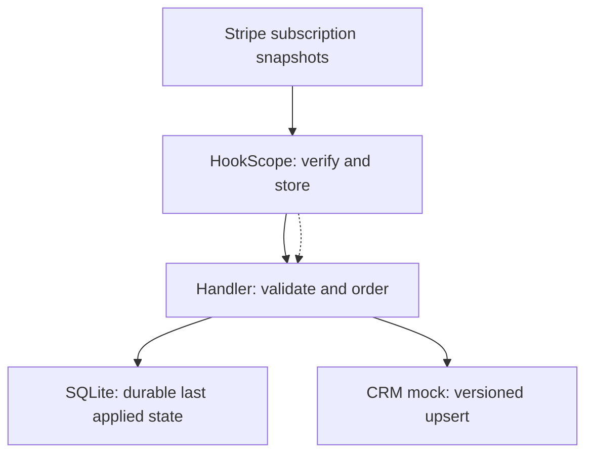
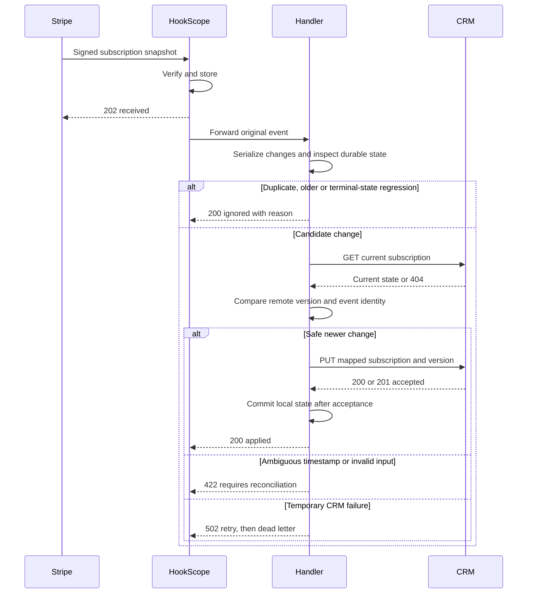

# stripe-subscription-lifecycle-to-crm

Keep the CRM's subscription state useful when Stripe sends duplicate events or delivers an older
snapshot after a newer one. This example targets the repository's CRM mock, not a certified vendor API.

| Part | Status |
|---|---|
| 1. Problem and architecture | done |
| 2. Config | done |
| 3. Core code | done |
| 4. Happy-path tests | to do |
| 5. Failure-mode tests | to do |
| 6. Troubleshooting | to do |
| 7. Customer pack | to do |

## 1. Problem and architecture

### Customer problem

Sales and support need a CRM record that distinguishes a trial, a paying customer, a payment problem
and an ended subscription. Delivery order is not lifecycle order: an old `customer.subscription.updated`
event can arrive after cancellation, and retries can deliver the same event repeatedly.

The handler accepts full subscription snapshots for `customer.subscription.created`,
`customer.subscription.updated` and `customer.subscription.deleted`. HookScope verifies Stripe's
signature and routes these topics; the handler maps state and controls ordering. Thin events requiring
an additional Stripe API fetch are outside this example.

### Architecture



### Delivery sequence



### State mapping

| Stripe status | CRM stage | Policy |
|---|---|---|
| `incomplete` | `pending` | Await initial payment |
| `trialing` | `trial` | Trial is in progress |
| `active` | `customer` | Current paying subscription |
| `past_due`, `unpaid`, `paused` | `at_risk` | Support or payment follow-up needed |
| `canceled`, `incomplete_expired` | `inactive` | Terminal for this subscription ID |

A newer snapshot can change any nonterminal status, including recovery from `past_due` to `active`.
Once terminal, a snapshot cannot revive the same subscription ID. A new subscription uses a new ID.
Deletion must carry `canceled` status; a contradictory deletion is rejected rather than guessed.

### Ordering and duplicate contract

- The CRM key is the subscription ID, scoped to one Stripe account per deployment.
- `event.created` supplies the integer version. Older versions are ignored; the same event ID at the
  same version is a duplicate. Distinct events with the same timestamp return 422 for reconciliation.
  Second-resolution timestamps are not a complete ordering key; this example does not invent an order
  by sorting event IDs or pretend it can resolve all same-second changes.
- One shared SQLite database serializes handler writes. The handler checks the CRM's current version
  and event ID before writing, so an accepted update whose response or local commit was lost can be
  recognized on retry. The CRM must preserve these fields and reject lower versions atomically.
- CRM 409 counts as stale only when its structured response reports a strictly newer version. Other
  conflicts remain visible failures. Uncoordinated external writers and multiple independent databases
  are outside the concurrency contract; do not deploy them against the same records.
- Local state advances only after target acceptance. Keep the database and HookScope's event store on
  persistent volumes. A failed write must remain retryable, not be remembered as delivered.
- The mapped CRM record contains subscription ID, customer ID, Stripe status, CRM stage, source event
  ID and version. It omits billing/payment details; the original webhook remains in HookScope's store.

The handler trusts HookScope's private forwarding network. It is not another public webhook verifier.
Protect receiver administration, isolate the handler and replace demo credentials before any deployment.

## 2. Config

[`rules.json`](rules.json) routes only the three subscription lifecycle topics to the handler.
Failures retry up to five times, with 2, 4, 8 and 16 seconds of backoff between attempts.
[`docker-compose.yml`](docker-compose.yml) extends the base receiver with a handler and the CRM mock.
The `subscription-state` volume holds the handler's SQLite database. The mock CRM itself is in memory;
restarting it loses its records. A real target needs its own persistence and backup policy.

| Setting | Purpose |
|---|---|
| `HOOKSCOPE_SECRET_STRIPE` | Receiver signing secret, supplied by `.env`; `make env` writes demo values |
| `CRM_BASE_URL` | CRM base URL, defaulting to the Compose mock for this example |
| `CRM_API_KEY` | Bearer key; the mock ignores its demo value |
| `CRM_TIMEOUT_SECONDS` | Per-request timeout, default 5 seconds |
| `STATE_DB_PATH` | Durable SQLite path, `/data/subscriptions.db` in Compose |
| `LOG_LEVEL` | Handler log level |

After the core handler is present, run from the repository root:

```bash
make up RECIPE=stripe-subscription-lifecycle-to-crm
curl -sS http://localhost:9003/subscriptions/sub_demo
```

The GET returns 404 until a subscription is sent. A signed subscription fixture and end-to-end demo
arrive with the happy-path test part. The core handler now supplies the application entry point.
The handler is not exposed on a host port. Do not use `make down` when preserving
recovery data: it removes volumes. With no Docker CLI available locally, configuration is checked by
the repository's YAML/routing tests; actual Compose validation and container startup remain CI/deployment checks.

## 3. Core code

[`handler/app.py`](handler/app.py) uses only Python's standard library. `snapshot` validates full
subscription events and maps status to CRM stage. `decision` applies ordering, duplicate and terminal
policy. `Handler` serializes updates with a SQLite write transaction, checks the CRM, sends its upsert,
then records success locally. CRM GET responses must include `id`, `version`, `event_id` and `status`.

`GET /healthz` checks process liveness, not CRM/disk readiness. `POST /stripe/subscription` accepts a
forwarded JSON body up to 1 MB. It returns 200 for applied/skipped/duplicate/stale/terminal events,
400 for unreadable JSON, 422 for invalid input or timestamp ambiguity, and 502 for temporary CRM/storage
failure. Unknown conflicts stay retryable rather than becoming silent success. Redirects are refused
so bearer credentials cannot travel to a redirected host.

[`test_subscription_core.py`](test_subscription_core.py) checks lifecycle changes, persistence across
handler restart, duplicate/stale/colliding timestamps, remote acceptance before local commit, 429/500
write recovery, shared-database concurrency, input validation and the actual HTTP endpoint. These core
tests do not replace the signed HookScope happy-path and full outage/replay tests in parts 4 and 5.

SQLite serializes CRM calls and limits throughput. Use one process or instances sharing a supported
local SQLite file, not separate databases or a network filesystem. The CRM mock is single-process test
infrastructure; its version check does not establish a vendor's concurrency guarantee. Validate the
real target's contract and size the timeout/serialization budget before production use.

## 4. Happy-path tests

To do: signed lifecycle fixtures through HookScope and the real HTTP handler to the CRM mock.

## 5. Failure-mode tests

To do: duplicates, reordering, timestamp collisions, target failures and replay after recovery.

## 6. Troubleshooting

To do: symptoms, diagnostics, observed logs and metric examples.

## 7. Customer pack

To do: FAQ, discovery questions and a go-live checklist.
