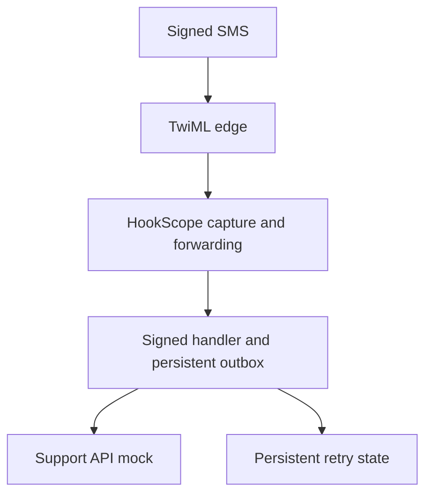
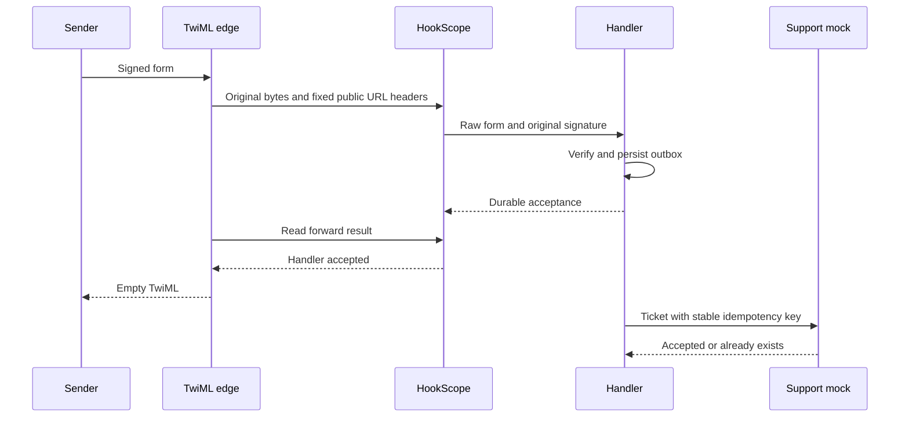

# Twilio SMS to support ticket

## Problem and scope

Turn a signed, form-encoded SMS into one support ticket, even after provider
redelivery, target outages or process restarts. This local demonstration runs
a TwiML edge, pinned HookScope, a durable handler and a vendor-neutral support
API mock. It is not a Jira integration or vendor certification.

## Architecture



HookScope validates the original signature and forwards the original form and
signature to the private handler. The handler independently validates against
the fixed public URL and commits an outbox record before returning success.
The edge polls the authenticated forward-history API for a successful
`inbound-sms` forward to the configured handler, then returns empty TwiML.
A HookScope capture receipt alone is insufficient for acknowledgement.



The support request is asynchronous. A provider 200 means durable acceptance,
not completed ticket creation. If the handler cannot confirm persistence within
the edge's bounded wait, the edge returns 503. HookScope may still finish later;
provider redelivery keeps the same identity and is safe. Configure provider
retry behavior separately.

## Run the synthetic demonstration

From the repository root, with Docker Compose available:

```sh
make up RECIPE=twilio-sms-to-support-ticket
docker compose -f docker-compose.base.yml -f recipes/twilio-sms-to-support-ticket/docker-compose.yml exec -T ingress python smoke.py
```

The smoke command sends a synthetic signed form through the edge, verifies one
ticket at the support mock, repeats the same identity, and rejects a bad
signature. Successful output is:

```text
SMS stack smoke passed: signed delivery, invalid signature and duplicate checks
```

The local edge is `http://127.0.0.1:8081/hooks/twilio` (override `SMS_PORT`).
Its configured signed URL is `https://sms.example.test/hooks/twilio`, an
illustrative URL, not a deployed HTTPS service. The smoke signs that fixed URL
while sending locally. Do not configure a live number with this example.

The HookScope dashboard is `http://127.0.0.1:8000`; its demonstration password
is `cookbook-sms-admin` (any Basic username). All example credentials in
`recipe.env` and Compose are public, synthetic values. Replace them through
secret configuration before any deployment with real data.

Only the edge and dashboard publish loopback ports. Handler and support ports
remain private. Named volumes preserve HookScope captures, handler state and
support-mock idempotency across container replacement. To stop without deleting
state:

```sh
docker compose -f docker-compose.base.yml -f recipes/twilio-sms-to-support-ticket/docker-compose.yml stop
```

Do not use `make down` for recovery: it deliberately removes volumes.
The support inspection endpoint `/_mock/tickets` requires its bearer credential
and is for synthetic testing only. It is not a production administration API.

## Fixed URL and trust boundary

Twilio signs the exact public HTTPS URL, including host, path and query, plus
all form parameters. The edge requires `/hooks/twilio` and replaces Host and
X-Forwarded-Proto for its private HookScope connection using trusted configuration.
Client Host or forwarding headers never select the signed URL. HookScope's pinned
proxy-aware server reconstructs that configured public URL. Keep its backend
network private; do not expose the trusted-proxy listener directly.

The handler verifies the original signature against the same explicit
`TWILIO_PUBLIC_URL`, never its internal URL. Unknown form fields participate in
verification. Duplicate parameters, malformed encoding and media messages are
rejected. Blank SMS bodies, Unicode and literal plus signs are preserved.
Forwarding headers alone cannot bypass the handler's signature check.

For a real TLS reverse proxy, preserve the original body and query and route
`/hooks/twilio` to the edge. Set the exact external HTTPS URL in the edge and
handler, and the same Twilio auth token in HookScope and the handler. If a query
is configured, put the identical query on `SMS_HANDLER_URL` and the rule's
`target_url` too, because the handler checks it. A query mismatch fails closed.
Never fix signature errors by disabling verification.

The edge uses a fixed internal HookScope URL, refuses redirects and sends its
administrator credential only to forward-history reads. Original credentials
from the incoming request are not copied. Each backend HTTP request has a
half-second timeout; polling has a two-second budget plus its final request.
Health endpoints report liveness, not target delivery or backlog readiness.

## Mapping and delivery

| Source | Ticket field |
| --- | --- |
| AccountSid and MessageSid | Account-scoped external reference and idempotency key |
| Body | Description, preserved as untrusted text |
| From | Restricted contact |
| To | Support destination |
| MessageSid | Summary and correlation |

New identities create separate tickets, including messages from the same
sender. Repeated identities with identical content reuse the same outbox and
target ticket. Reusing an identity with changed content returns conflict.
Conversation threading, media downloads and outbound SMS are outside scope.

The `inbound-sms` HookScope rule forwards raw forms without a JSON event-type
filter. Invalid signatures do not match. Its five attempts protect handoff to
the durable handler. The handler worker separately persists its own five-attempt
budget for transport errors, 408/425/429 and 5xx; permanent errors enter review.
The target must retain idempotency across response loss and restarts. The mock
does so in its own SQLite volume, with a bearer credential and the same stable
external reference.

See [Runtime](RUNTIME.md), [Scheduled delivery](WORKER.md),
[HTTP delivery](HTTP-DELIVERY.md), [Testing](TESTING.md) and
[Troubleshooting](TROUBLESHOOTING.md) for component contracts and recovery.

## Validation and remaining scope

The Compose base builds HookScope at
`b4e012c304ea69ca29fd544ab0ab2864e5cf11f6`, matching the test dependency.
CI requires Compose validation, container builds and the running signed stack
smoke, as well as the full suites and completed-recipe matrix. There is no
moving-head dependency in this demonstration.

The recipe retains `.wip` until its customer handover material is complete.
The local stack is executable; a live deployment still needs actual TLS,
secret management, network controls, retention, rate-limit sizing and verified
provider retry settings. Synthetic tests do not certify a real support vendor.
