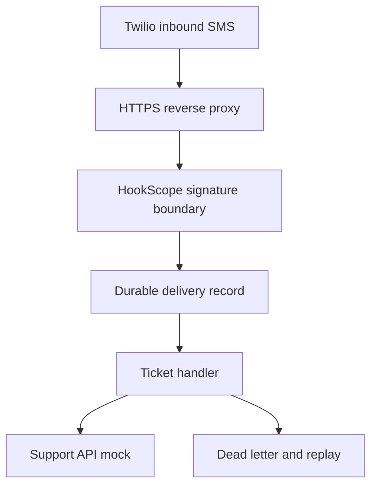
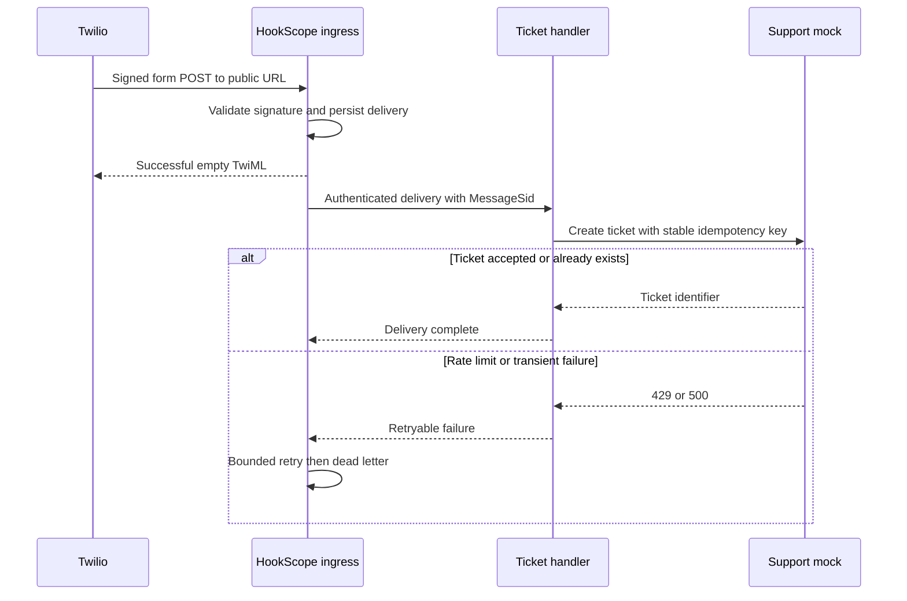

# Twilio SMS to support ticket

## Problem and scope

Turn an inbound SMS into a support ticket without losing messages during a target outage or creating duplicate tickets after redelivery. This recipe designs the boundary between Twilio, HookScope, a ticket handler and a generic support API mock. It is an architecture specification; configuration, handler code and executable scenarios follow separately. It does not claim compatibility with a particular support vendor.

Inbound messaging webhooks carry `application/x-www-form-urlencoded` fields, including `MessageSid`, `AccountSid`, `From`, `To` and `Body`. They are not JSON. Parse form encoding once, preserving blank values and Unicode; do not trim, normalize or re-encode values before signature verification. Reject ambiguous duplicate parameter names rather than silently choosing a value. Unknown fields must participate in verification.

## Architecture

The receiving boundary validates the request before accepting work. It returns a successful TwiML response, such as `<Response/>`, only after durable acceptance. An empty response sends no automatic SMS reply. Authentication failures must not create tickets or enqueue work. A failure before durable acceptance returns an error, with provider retry behavior configured and verified separately.

Durable acceptance, retry storage and safe replay are requirements for the implementation, not guarantees of this architecture page. If the pinned HookScope version cannot satisfy a requirement, the subsequent configuration and handler work must supply it explicitly before go-live.

## Signature and proxy boundary

Twilio signs the exact externally configured webhook URL, including its scheme, host, path and query string, together with the form parameters using the account auth token. Validate `X-Twilio-Signature` with a maintained Twilio validator or a tested equivalent. A proxy that changes HTTPS to HTTP, strips a path prefix or rewrites the host can make an authentic request fail verification.

Configure the public webhook URL explicitly. Do not construct it from arbitrary client-provided forwarding headers. If trusted proxy metadata is used, restrict direct ingress and define which proxy can set those headers. Preserve the original form body and content type through the proxy. Outbound forwarding to the ticket handler requires its own authentication; the handler must not attempt to validate the original Twilio signature against its internal URL.

Keep the auth token in secret configuration. Never log it, signatures, full phone numbers or SMS bodies. Correlate deliveries with `MessageSid` and a request identifier; redact personal data in diagnostic examples.

## Delivery sequence

## Mapping and delivery policy

| Source | Target use |
| --- | --- |
| AccountSid and MessageSid | Durable deduplication key scoped to the sending account |
| Body | Ticket description, treated as untrusted text |
| From | Restricted contact field, subject to retention policy |
| To | Support destination or routing key |
| MessageSid | External reference and correlation identifier |

Create one ticket per inbound message, not one per phone number. A new message from the same sender creates another ticket. Conversation threading and outbound replies are outside this recipe. Attachments are outside the initial SMS scope; do not fetch arbitrary media URLs.

Persist the mapping from account/message identity to ticket identifier. Concurrent deliveries require atomic claims or a unique constraint. Pass a stable target idempotency key where supported. If the target accepts a request but the response is lost, reconcile by external reference before creating again. Local deduplication alone cannot guarantee exactly-once creation across that failure window.

Honor target rate limits with bounded backoff and jitter. Retry transient transport failures, 429 and selected 5xx responses. Route permanent validation failures to operator review. Preserve the same identity during replay; never manufacture a new message identity to bypass deduplication. Retain failed work durably with a documented retention period and access controls.

## Acceptance criteria for the runnable recipe

- A valid signed form creates one ticket with Unicode and blank fields preserved.
- A modified body, wrong token or mismatched public URL is rejected before side effects.
- Trusted proxy configuration validates the public URL while internal URL reconstruction fails predictably.
- Duplicate and concurrent deliveries create one ticket; different message identities remain independent.
- Target 429/500, response loss after acceptance, restart and outage replay retain identity and avoid duplicate creation.
- Required integration tests execute with the pinned HookScope dependency and local mocks.

## Implementation status

Only problem and architecture are defined here. Deployment configuration, handler, signed fixtures, failure tests, troubleshooting evidence and customer go-live material are still required before this recipe is runnable.
