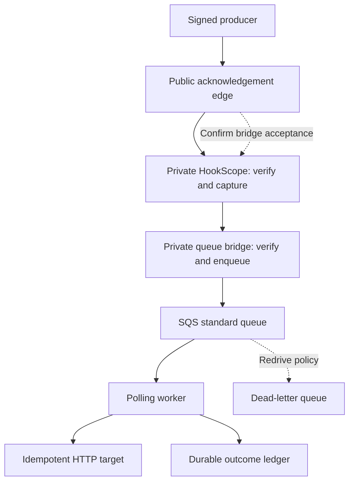
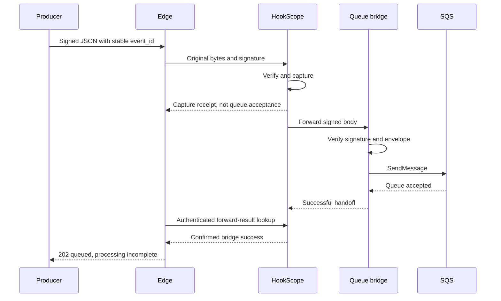
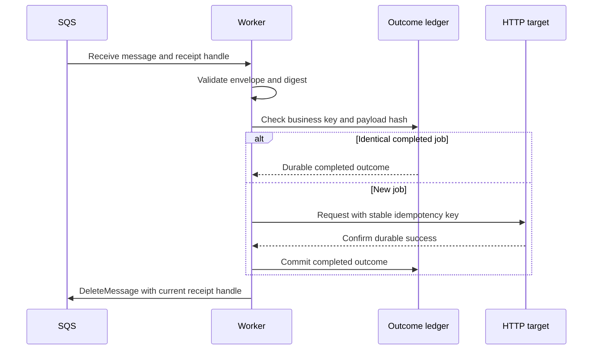

# Webhook to queue on AWS

A customer wants webhook responses to remain quick while a slow business system
is unavailable, without acknowledging work that has not reached durable storage.

**Architecture specification.** This folder describes the queue handoff and worker
contracts. It does not yet contain a runnable stack, handler, worker, Terraform
module or executable acceptance tests. Its `.wip` marker keeps it outside the
completed-recipe test matrix. Existing recipe and documentation checks still run.
No cloud resources are created by this document.

## Problem and scope

Use a signed generic HMAC JSON event to request one independent background job.
HookScope verifies and captures the request, a private bridge enqueues it in an
SQS standard queue, and a polling worker delivers it to a vendor-neutral target.
Local validation uses LocalStack and an idempotent HTTP mock; it is not AWS
production validation or certification of a business-system vendor.

The source supplies a stable `event_id` and retries the identical body under that
identity when acknowledgement is absent. Each deployment has a trusted configured
namespace. The business key is the namespace plus `event_id`, not an SQS MessageId,
receipt handle or HookScope capture id. Redelivery may create new capture and queue
records while retaining that business key.

Jobs are independent. Ordering-sensitive subscription updates, FIFO ordering,
large-object storage, multiple tenant credentials and exactly-once side effects
are outside this contract. Generic HMAC proves possession of the signing secret;
it does not itself impose timestamp freshness. Replay safety depends on durable
business-key deduplication, not a claim of time-window replay protection.

## Architecture

### Public acknowledgement boundary

The producer calls only the edge. HookScope's raw capture endpoint is private:
its normal 202 receipt does not prove a queue write. The edge submits the original
body and signature to HookScope, requires a valid verification result and the
intended queue rule, then checks authenticated forward history for a successful
bridge response to the configured bridge URL.

The bridge independently verifies the signed bytes and validates the job envelope.
It returns success only after `SendMessage` succeeds. The edge returns 202 only
after observing that bridge success. This is queued acceptance, not completed
business processing. Queue acceptance can complete before the producer response,
so the worker may begin immediately; there is no promise that work waits for that
response to arrive.

Set bounded request timeouts and an overall edge deadline shorter than the
producer's response timeout. The edge waits only for queue handoff, never for the
business target. Its deadline and the producer's retry policy must be measured
together. A valid signature with no matching rule, a failed queue write, missing
administrative access or an unconfirmed handoff must not produce success.

If the edge times out after SQS accepted the message, it returns a retryable error
rather than guessing success. A later producer retry or HookScope forward retry
can enqueue another copy. Queue duplicates are acceptable; duplicate business
effects are not. Never create a new business identity merely to resolve an
uncertain acknowledgement.

The edge must match the exact capture id, rule and configured bridge URL when
checking history. It must not treat an unrelated successful forward, a failed
signature, a generic capture receipt or an empty history list as acceptance.
Administrative credentials go only to the private history API and never into
forwarded events or SQS messages. Redirects cannot select another credential
destination.

### Worker completion boundary

SQS standard delivery can repeat and arrive out of order. Visibility temporarily
hides received work; it is not a deduplication guarantee. The worker uses manual
deletion and the receipt handle belonging to its current receive.

The ledger records the business key, body digest and outcome on persistent storage.
An identical completed job skips the target and can be deleted from the queue.
Reusing a business key with a different digest is a conflict and must not overwrite
the previous outcome or silently become a second business action.

A target success is accepted only under an explicit durable-success contract.
Do not treat an arbitrary 202, redirect or unrelated 409 as completed work.
For a synchronous mock, a documented successful response confirms the idempotent
write. An asynchronous real target needs a separate completion/reconciliation
adapter before this contract can apply.

A worker can crash after the target commits but before its ledger commit.
The next attempt must reuse the same target idempotency key. The target's durable
deduplication or authoritative reconciliation closes that window; the local ledger
alone cannot guarantee exactly-once effects. After a ledger commit but before queue
deletion, a repeated receive is safe because the completed outcome is already known.

## Message contract

The bridge accepts a UTF-8 JSON object with an `event_id` matching
`[A-Za-z0-9._:-]{1,128}`, `kind: "support.job"` and an object-valued `data`.
Reject duplicate JSON keys and unsupported kinds. The trusted namespace matches
`[a-z0-9-]{1,32}`; the target external reference and idempotency key are
`namespace:event_id`. The target job carries that reference and the approved
`data` mapping. The producer must resend the same
signed bytes for the same identity. Use synthetic fixtures with Unicode, empty
values and reserved JSON characters.

The queue message is a versioned JSON envelope with these fields:

| Field | Contract |
| --- | --- |
| schema_version | Explicit version; unknown versions are rejected by the worker |
| namespace | Trusted deployment configuration, never a client-selected tenant |
| event_id | Producer identity, retained across every delivery attempt |
| body_base64 | Exact verified source bytes, encoded for the queue envelope |
| body_sha256 | Digest of those bytes; checked before processing and against the ledger |
| capture_id | Optional correlation only; never a deduplication key |

The bridge enforces a 64 KiB raw-body limit and a 128 KiB encoded-envelope limit before
calling SQS. Base64 expansion and metadata count toward the envelope budget.
These are chosen application bounds rather than claims about the
service's maximum message size. Payloads exceeding them fail acceptance; no hidden
truncation or fallback object upload is permitted.

Do not enqueue credentials, cookies or all captured headers. The worker receives
only the validated envelope and uses its own target credential. Keep source
signature verification separate from outbound target authentication.

## Retry and recovery contract

There are two retry domains: HookScope's bounded bridge handoff attempts and the
queue's worker receives. They must not share counters or turn a capture receipt
into an acknowledgement.

| Failure | Required behavior |
| --- | --- |
| Invalid signature or job envelope | Reject before SQS; no target work |
| SendMessage unavailable or acceptance response uncertain | No confirmed success to producer; retry may enqueue duplicates using the same business key |
| Edge expires after the queue accepted | Retryable edge response; preserve identity and reconcile, allowing duplicate queue records |
| Worker crashes before target call | Leave message undeleted; another receive can process it |
| Target transport error, 408, 425, 429 or 5xx | Leave undeleted and schedule bounded retry through visibility, with jitter/backoff policy |
| Target returns a permanent error | Record a restricted diagnostic outcome, stop repeated target calls for that unchanged job, and leave undeleted for configured DLQ handling |
| Target committed but its response was lost | Reuse the key and reconcile; never assume the side effect did not occur |
| Ledger committed but DeleteMessage failed | Next receive uses the completed outcome and retries deletion with its current receipt handle |
| Payload hash conflicts with a recorded identity | Quarantine for operator review; never overwrite or automatically replay as new work |
| Retry/receive budget exhausted | Move through the configured redrive policy to the DLQ; require reviewed recovery |
| Queue or DLQ retention expires | Data can be lost; alert and reconcile before expiry rather than relying on unlimited retention |

Use bounded target and database operations within a visibility budget that also
allows outcome persistence and deletion. Long-running work needs an explicit
visibility-extension policy. Shutdown stops new receives and finishes or releases
in-flight work without deleting unfinished messages. Visibility is not a lock that
eliminates all duplicates.

Keep deduplication evidence for the entire queue, DLQ and authorized manual-replay
window. Restore the ledger, target records and deduplication state consistently.
A DLQ is a recovery queue, not a permanent archive. Do not automatically redrive
poison or conflicting jobs without investigation.

## Trust, storage and deployment boundaries

The edge is the only producer-facing endpoint. HookScope administration, bridge,
worker and target belong on private networks with authenticated access. Use TLS,
injected secrets and restricted service roles for real deployments. The bridge
needs permission to send only to its queue; the worker needs the scoped receive,
visibility and deletion actions. Queue administration and redrive are separate
operator permissions.

Captures, queue messages, DLQ records, ledger state, targets and backups can retain
personal data. Define access, encryption, retention and coordinated deletion across
all of them. Correlation logs should contain identifiers, outcomes and timings,
not bodies, signatures, tokens or full queue receipt handles.

The local architecture uses LocalStack instead of a live AWS account and a durable
idempotent target mock. An infrastructure module must pass Terraform format and
validation checks in CI before it is considered usable. No Terraform module or
deployment command is supplied here; validation and LocalStack cannot establish
live-account IAM, network, encryption, durability, quota or cost behavior.
Infrastructure is never applied by the recipe's validation workflow.

## Acceptance evidence required for an executable recipe

- Signed synthetic ingress reaches SQS before producer success; invalid signatures,
  unmatched rules and failed queue writes never receive successful acknowledgement.
- A worker eventually creates the exact mapped target job, commits its outcome and
  deletes with the current receipt handle.
- Identical redelivery, multiple SQS copies, out-of-order independent jobs and worker
  restart retain one business effect and the same key.
- Target 429/500, slow calls, response loss, a crash around ledger commit and a failed
  queue deletion preserve recoverability without resetting identity.
- Permanent errors, conflicting payloads and exhausted receives reach operator review
  or the configured DLQ path without silent deletion or unbounded target calls.
- Queue/DLQ retention and idempotency retention are tested together; restore and
  reviewed redrive preserve the approved reconciliation boundary.
- Full Python suites, a nonempty per-recipe suite, runnable local stack checks and
  Terraform validation provide evidence before the design is marked runnable.

These are acceptance requirements, not claims that the implementation already exists.

## AWS references

The queue semantics above follow these primary references, reviewed November 25, 2026:

- [Standard queues and duplicate/out-of-order delivery](https://docs.aws.amazon.com/AWSSimpleQueueService/latest/SQSDeveloperGuide/standard-queues.html)
- [Visibility timeout and processing failures](https://docs.aws.amazon.com/AWSSimpleQueueService/latest/SQSDeveloperGuide/sqs-visibility-timeout.html)
- [DeleteMessage and the current receipt handle](https://docs.aws.amazon.com/AWSSimpleQueueService/latest/APIReference/API_DeleteMessage.html)
- [Dead-letter queues and redrive policy](https://docs.aws.amazon.com/AWSSimpleQueueService/latest/SQSDeveloperGuide/sqs-dead-letter-queues.html)

The edge/bridge/ledger choices are this recipe's design decisions, not AWS-provided
end-to-end delivery guarantees.
